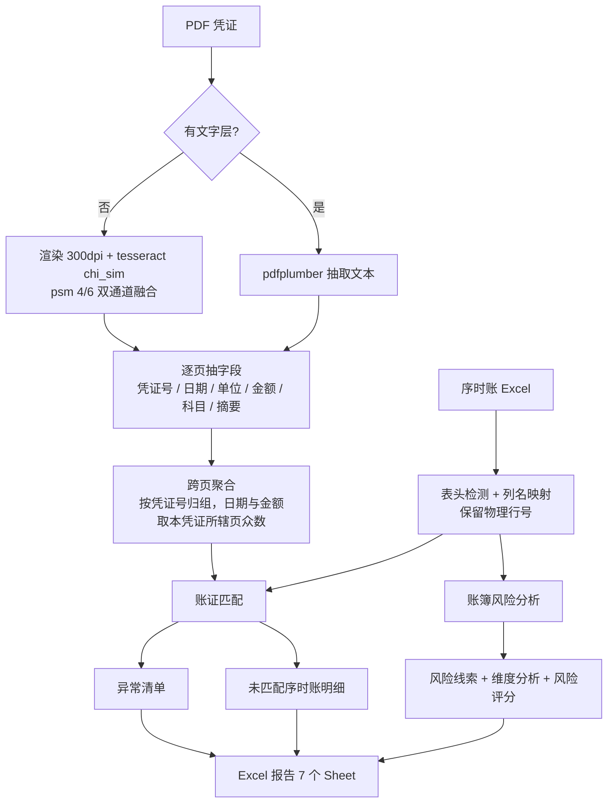

# AI 财务凭证智能核查与风险分析系统

把 PDF 会计凭证与 Excel 序时账逐笔对上，并把账簿本身的可疑迹象整理成带证据的线索。

> 定位：财务资料核查的**辅助工具**。输出的是待核查线索，不是审计结论；
> 金额是否一致由精确比较决定，模型只在配置了 Key 时负责把结论写成中文说明。

> 🔗 **在线演示**：<https://a91a5ee45b373f309.app.workbuddy.link>
> （免装环境，上传 PDF + Excel 即可体验）

---

## 目录

- [一、解决什么问题](#一解决什么问题)
- [二、实际跑出来的样子](#二实际跑出来的样子)
- [三、架构与数据流](#三架构与数据流)
- [四、快速开始](#四快速开始)
- [五、能力详解](#五能力详解)
- [六、评估结果](#六评估结果)
- [七、设计取舍](#七设计取舍)
- [八、项目结构](#八项目结构)
- [九、开发与测试](#九开发与测试)
- [十、已知限制](#十已知限制)
- [十一、合规声明](#十一合规声明)

---

## 一、解决什么问题

财务复核最耗时的一步，是把凭证和账簿一笔一笔对。核对本身不难，难的是三件事：

| 痛点 | 本项目的做法 |
|---|---|
| 对不上的地方记不住、说不清 | 每个差异都带 PDF 页码、账内物理行号、差额、匹配方式 |
| 账里有、凭证没有的，容易被漏掉 | 未匹配明细单独成表，带行号可回原表 |
| 只看单笔看不出问题 | 金额离群、期末集中、重复入账等七类账簿级线索 |

系统回答三个问题：

1. 账里的每一笔，有没有凭证支撑？
2. 凭证里的每一张，账里有没有入账？
3. 账簿本身，有没有值得进一步看的迹象？

---

## 二、实际跑出来的样子

用仓库自带的演示集（`data/demo_recon`：7 张 PDF 凭证、8 张账内凭证）跑出来的真实结果：

```
PDF 凭证: 7 | 序时账凭证: 8
已匹配: 4 | 日期不一致: 1 | 金额不一致: 1
PDF_ONLY: 1 | 疑似匹配: 0 | OCR 不确定: 0
LEDGER_ONLY(信息性): 2
匹配率: 85.7%
```

逐笔结果（节选自报告「核对结果」Sheet）：

| PDF凭证号 | PDF借方 | PDF科目 | 账内凭证号 | 账内行号 | 借方差异 | 状态 |
|---|---|---|---|---|---|---|
| 0001 | 528,551.91 | 原材料 | (记)-2025-01-0001 | 2,3 | 0 | 已匹配 |
| 0002 | 1,240,000.00 | 应收账款 | (记)-2025-01-0002 | 4,5 | 0 | 已匹配（跨两页聚合） |
| 0003 | 320,300.77 | 咨询费 | (记)-2025-02-0003 | 6,7 | -2,000.00 | 金额不一致 |
| 0004 | 95,000.00 | 运输费 | (记)-2025-02-0004 | 8,9 | 0 | 日期不一致 |
| 0012 | 777,777.77 | 原材料 | — | — | — | PDF有/账里无 |

---

## 三、架构与数据流



分层：

| 层 | 模块 | 职责 |
|---|---|---|
| 解析 | `tools/pdf_parser.py`、`tools/ocr.py` | 判断文字层，扫描件走 OCR |
| 抽取 | `tools/voucher_extractor.py` | 凭证字段与分录行 |
| 解析 | `tools/excel_analyzer.py` | 表头检测、列名映射、行号保留、按凭证聚合 |
| 匹配 | `tools/reconciliation.py` | 五级阶梯 + 多候选 + 疑似判定 |
| 检测 | `tools/anomaly_detector.py` | 把匹配差异翻译成异常条目 |
| 分析 | `tools/ledger_risk_analyzer.py` | 七类账簿级线索 |
| 输出 | `tools/report_generator.py` | 7 个 Sheet 的 Excel |
| 编排 | `agent/orchestrator.py`、`agent/batch.py` | 单文件 / 多文件 |
| 展示 | `app.py`、`pages/` | Streamlit 五页 |
| 评估 | `evaluation/` | 在标准答案上算指标 |

**确定性逻辑全部是纯 Python**。LLM 只在配置 `OPENAI_API_KEY` 时介入，把已有结论写成自然语言，不参与任何数值判断。

---

## 四、快速开始

### 1. 安装

```bash
git clone https://github.com/beiillee/ai-voucher-agent.git
cd ai-voucher-agent
python3 -m venv .venv && source .venv/bin/activate
pip install -r requirements.txt
```

OCR 需要系统级 Tesseract 与中文包（只在扫描件时用到，文字层 PDF 不需要）：

```bash
# Ubuntu / Debian
sudo apt install tesseract-ocr tesseract-ocr-chi-sim
# macOS
brew install tesseract tesseract-lang
```

### 2. 三种运行方式

```bash
# 网页版（推荐）
streamlit run app.py

# 命令行
python3 main.py data/demo_recon/vouchers.pdf data/demo_recon/ledger.xlsx output/

# 评估：在演示集上跑指标
python3 -m evaluation.run
```

### 3. 先用演示数据验证环境

网页版打开后，在「数据核对」页打开侧边栏的**使用内置演示数据**，点「开始核对」。
预期看到：7 张 PDF 凭证、已匹配 4、匹配率 85.7%、账内未覆盖 2。

命令行等价：

```bash
python3 -c "from agent.orchestrator import run; \
  run('data/demo_recon/vouchers.pdf','data/demo_recon/ledger.xlsx',output_dir='output')"
```

---

## 五、能力详解

### 5.1 账证匹配

匹配阶梯由强到弱，每次降级都会写进 `match_method`：

| 阶梯 | 依据 | 置信度基数 |
|---|---|---|
| P1 | 凭证类型 + 期间 + 编号 | 1.0 |
| P1b | 期间 + 编号（类型被 OCR 误识） | 0.9 |
| P2 | 仅编号（跨期，命中后标记日期不一致） | 0.7 |
| P3 | 金额 + 期间（编号完全对不上时的退路） | 0.55 |
| P4 | 编号模糊匹配（容 OCR 把 1211 识成 121l） | 0.6 |

六种结果状态：

| 状态 | 含义 |
|---|---|
| `MATCHED` | 凭证号、期间、金额全部一致 |
| `DATE_MISMATCH` | 凭证能对应，期间不同 |
| `AMOUNT_MISMATCH` | 凭证能对应，金额有差异 |
| `SUSPECTED` | 多个候选金额同样吻合，**无法唯一确定**，不下结论 |
| `PDF_ONLY` | 凭证存在，账里找不到 |
| `OCR_UNCERTAIN` | 凭证号未识别 |

三条硬约束：

- **不静默覆盖**：索引的每个键挂列表，同号凭证全部保留
- **不静默丢数据**：每张凭证要么匹配上，要么出现在未匹配明细里
- **不强行拍板**：金额同样吻合的候选超过一个，只报疑似并附候选明细

### 5.2 异常检测

11 类，每条带凭证号、页码或行号、详情：

`PDF_ONLY`、`AMOUNT_MISMATCH`、`DATE_MISMATCH`、`VOUCHER_NO_MISMATCH`、
`DUPLICATE_VOUCHER`、`DUPLICATE_LEDGER`、`NON_UNIQUE_MATCH`、`AMBIGUOUS_MATCH`、
`KEY_FIELD_MISSING`、`OCR_UNCERTAIN`、`LEDGER_ONLY`

其中 `LEDGER_ONLY` 与「PDF 内部借贷不平」标为**信息性**（`is_info`），不计入实质异常，
避免方法学提示混进问题清单。

### 5.3 风险分析

七类线索，每条都带**基线、比较组与样本数、偏离程度、检测方法、判断依据、建议核查动作、证据定位**：

| 类型 | 触发条件 | 等级 |
|---|---|---|
| 金额离群 | 同科目比较组内 IQR 或稳健 Z 超阈值 | 高/中 |
| 期末集中入账 | 月末 3 天入账占比显著高于其余时段 | 高/中 |
| 周末入账 | 全簿周末入账占比很低，但某笔落在周末 | 中/低 |
| 月度剧烈波动 | 相邻月份发生额变动超阈值 | 中 |
| 重复交易 | 金额 + 摘要 + 对手方逐字相同、跨凭证 | 高/低 |
| 疑似重复 | 同额，摘要相似度 0.75–1.0 | 中/低 |
| 结构变化 | 某科目占期间总额比例变动超 5 个百分点 | 中 |

**样本不足时不出结论**：比较组少于 8 条直接跳过，并在「风险概览」里列明跳过了哪些科目。

风险评分是可复算的，公式随结果一起输出：

```
raw  = 高×10 + 中×4 + 低×1
密度 = raw / max(记录数, 50) × 100
分数 = min(100, 密度 × 2)
```

分母设 50 条下限，避免几十条记录的小账套里 1 条线索就把分数顶满。
分数只用于账套之间粗比，不代表违规概率。

### 5.4 报告

`batch_reconciliation_result.xlsx` 共 7 个 Sheet：

| # | Sheet | 内容 |
|---|---|---|
| 1 | 核对结果 | 逐笔比对，含科目、页码、账内行号、候选数 |
| 2 | 异常清单 | 对不上的地方，信息性条目单独标注 |
| 3 | 未匹配序时账 | 账有、PDF 未覆盖的明细（带行号） |
| 4 | 风险线索 | 七要素齐全，可直接照着核查 |
| 5 | 风险概览 | 各类分析是否执行、是否降级，附方法论说明 |
| 6 | 维度分析 | 科目 / 月份 / 部门汇总 + 评分口径 |
| 7 | 统计汇总 | 各项计数与匹配率 |

---

## 六、评估结果

`python3 -m evaluation.run` 在演示集上的实测（标准答案见 `data/demo_recon/labels.json`）：

| 指标 | 结果 |
|---|---|
| 字段抽取准确率 | 100%（28/28） |
| 匹配 Precision / Recall / F1 | 100% / 100% / 100% |
| 状态判定准确率 | 100% |
| 异常 Precision / Recall / F1 | 100% / 100% / 100% |
| 凭证级误报率 | 0% |
| 端到端耗时（中位数，3 次） | 0.108 s |
| 峰值内存 | 1.0 MB |
| 批量失败率 | 0%（2 个文件） |

> **这组数字必须带着上下文看。** 演示集是程序生成的回归基准，覆盖的是"完全匹配、
> 金额差异、日期差异、双向缺失、重复入账"这些典型情形，清晰度也是理想的。
> 它的作用是**防止改动引入退化**，不代表真实扫描件上的效果。
> 真实扫描件的 OCR 会出错，那时字段准确率会明显下降 —— 这也是为什么系统
> 对识别不确定的凭证给 `OCR_UNCERTAIN` 而不是猜一个值。

评估口径：

- 匹配：找错对象时**同时**计 FP 与 FN，不用「找到了一张就算对」虚高召回
- 异常：`is_info` 条目不计入 TP/FP
- 一致性：summary 各项相加必须等于 `total_pdf`，有测试守着

---

## 七、设计取舍

**为什么不用 LLM 判断金额？**
金额是否一致是确定性事实，交给概率模型只会引入不可解释的错误。LLM 只把已有结论写成中文。

**为什么没有多 Agent / LangGraph？**
这个任务的复杂度在数据链路，不在编排。多一层 Agent 只会让「哪一步出的错」更难定位。

**为什么同号凭证不合并？**
财务上重号并非罕见（跨期重号、补录重号）。合并会让重复入账永远查不出来。

**为什么多候选项要报"疑似"而不是选一个？**
选错了比不选更糟 —— 会让人以为已经核对过了。宁可多一步人工确认。

**为什么样本不足就跳过？**
8 条样本算出来的"基线"没有统计意义。跳过并在概览里说明，比给一个不可靠的结论好。

---

## 八、项目结构

```
.
├── app.py                      # Streamlit 首页
├── pages/                      # 四个功能页
│   ├── 1_数据核对.py
│   ├── 2_风险分析.py
│   ├── 3_评估结果.py
│   └── 4_使用说明.py
├── ui_utils.py                 # 页面共用
├── main.py                     # CLI（含双击模式）
├── agent/
│   ├── orchestrator.py         # 单文件端到端
│   ├── batch.py                # 多文件批量 + 汇总报告
│   └── prompts.py
├── tools/
│   ├── schema.py               # 统一字段口径
│   ├── pdf_parser.py
│   ├── ocr.py
│   ├── voucher_extractor.py
│   ├── excel_analyzer.py
│   ├── reconciliation.py
│   ├── anomaly_detector.py
│   ├── ledger_risk_analyzer.py
│   └── report_generator.py
├── evaluation/
│   ├── metrics.py              # PRF / 准确率 / 误报率
│   ├── evaluate.py             # 跑演示集算指标
│   └── run.py                  # CLI
├── data/
│   ├── sample_voucher.pdf      # 最小样例（文字层）
│   ├── sample_ledger.xlsx
│   ├── demo_ledger.xlsx        # 1070 行，埋入 5 类异常
│   └── demo_recon/             # 账证核对演示集 + labels.json
├── tests/                      # 94 个用例
└── output/
    └── evaluation/             # 评估报告（实测产物）
```

---

## 九、开发与测试

```bash
python3 run_tests.py             # 全部用例
python3 -m unittest tests.test_data_integrity -v   # 单模块
```

测试分十组：

| 文件 | 覆盖 |
|---|---|
| `test_reconciliation.py` | 匹配阶梯 P1/P1b/P2/P4、金额差异、PDF_ONLY |
| `test_data_integrity.py` | 同号不覆盖、重号可检出、不丢数据、疑似判定、行号保留 |
| `test_voucher_extractor.py` | 字段抽取、跨页聚合、金额清洗 |
| `test_excel_analyzer.py` | 表头检测、列名映射、聚合 |
| `test_anomaly_detector.py` | 11 类异常与信息性条目 |
| `test_risk_scoring.py` | 疑似重复、评分可复算、三维度、部门列识别 |
| `test_report_generator.py` | 7 个 Sheet、表头、非空校验 |
| `test_evaluation.py` | 评估器自身（TP/FP/FN 归位、is_info 排除） |
| `test_batch.py` | 多文件隔离、单文件失败不影响整批、未覆盖只算一次 |
| `test_integration.py` | 端到端 + 演示集逐项比对标注 |

**验收标准写进测试**，例如：

- `test_summary_sums_to_total`：分项之和必须等于总数
- `test_duplicate_detection_reachable`：重号必须能被检出（旧实现里永远为 1）
- `test_unique_candidate_still_conclusive`：加了疑似判定后，唯一候选仍要给确定结论

---

## 十、已知限制

1. **扫描件 OCR 有上限**。倾斜、模糊、印章遮挡会显著降低凭证号与金额的识别率。
   系统对识别失败给 `OCR_UNCERTAIN`，不猜。
2. **演示集指标偏乐观**。见[第六节](#六评估结果)的说明，那是回归基准，不是泛化能力。
3. **多文件不做跨文件去重**。两个文件里出现同一张凭证，会各算一次。
4. **科目抽取依赖词表**。企业自定义的冷门科目可能抽不到；抽不到时 `unparsed_fields`
   会列出 `accounts`，不会静默当作正常。
5. **风险分析只覆盖七类**。不涉及关联方、资金流水、发票真伪等需要外部数据的判断。
6. **没有权限体系**。这是单机工具，不适合直接多人共用。

---

## 十一、合规声明

- 本工具是**财务资料核对辅助工具**，不声称能自动完成审计、自动判定财务造假或替代审计人员。
- 所有输出均为**待核查线索**，最终判断须由具备资质的财务/审计人员作出。
- 统计异常不等于违规。金额比较在比较组内进行，样本不足时不出结论。
- 报告保留原始数据、抽取结果、匹配依据、异常原因与置信度，确保可追溯。
- 仓库内所有数据均为程序生成的虚构样例，不含任何真实企业财务信息。

---

## 附：可选 LLM 配置

不配置也能完整运行。配置后，仅对非匹配结果生成自然语言解释：

```bash
cp .env.example .env
# 编辑 .env，填入你自己的 Key（兼容 OpenAI 协议的服务均可，如 DeepSeek）
```

```ini
OPENAI_API_KEY=your_key_here
OPENAI_BASE_URL=https://api.deepseek.com/v1
LLM_MODEL=deepseek-chat
```

网页版勾选「启用 LLM 异常解释」后生效；命令行加 `--use-llm`。
